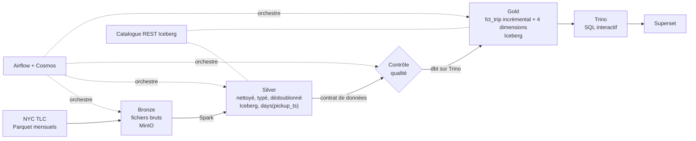
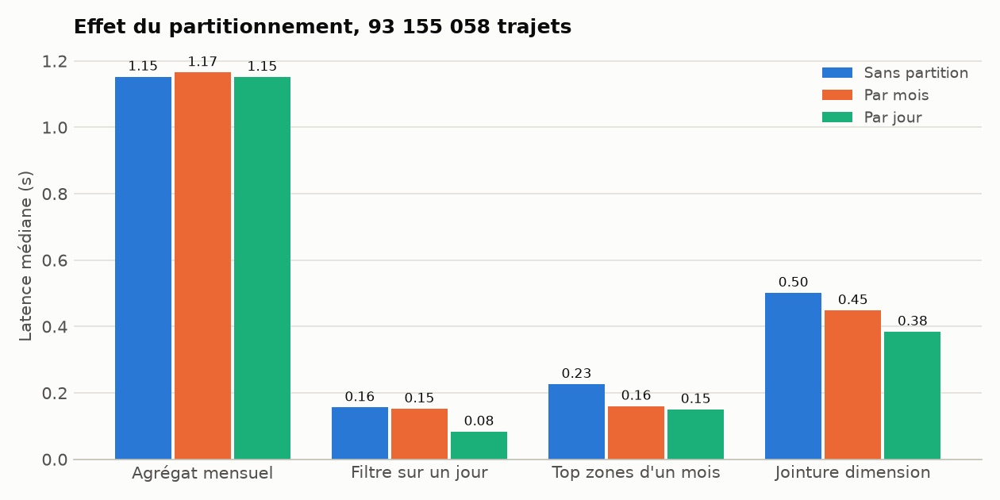
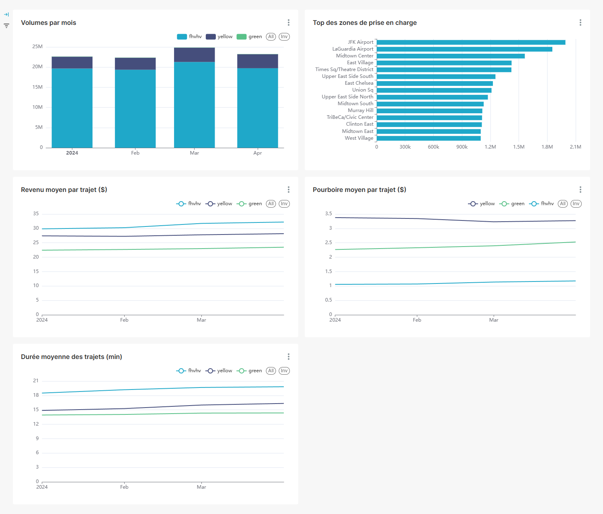

# OpenLakehouse

**93 155 058 trajets réels de taxi et VTC new-yorkais, de fichiers bruts à un modèle en étoile testé, sur une architecture lakehouse 100 % open source qui tient sur un seul PC.**

Le livrable principal est **l'architecture justifiée** autant que le code. Chaque choix structurant a son ADR, et chaque affirmation de performance vient d'un benchmark reproductible.


[](https://github.com/Aminebousmah/OpenLakehouse/actions/workflows/ci.yml)

## L'architecture



## Ce qui est mesuré

Volumétrie réelle : janvier à avril 2024, services yellow, green et fhvhv.

| Mesure | Résultat |
|---|---:|
| Lignes en gold | 93 155 058 |
| Bronze, fichiers d'origine | 2,0 Gio |
| `fct_trip`, sur disque | 4,99 Go |
| Spark, un mois de bronze à silver | 46 à 51 s |
| Démarrage de l'infra, images déjà construites | 22 s |
| Un mois de bronze à gold depuis une infra vide | 97 s |
| Contrôle d'un mois rechargé | 22 377 762 lignes avant et après |
| `dbt build` | 17 réussis, 0 erreur |
| Violations du contrat de données | 0 |

Gold pèse plus lourd que bronze, et c'est un coût assumé : `trip_id` est un hash SHA-256, donc une chaîne incompressible. La source n'ayant aucun identifiant naturel, ce hash est ce qui permet le dédoublonnage et les corrections par `MERGE`. Une clé plus courte serait la première optimisation à tester.

### Benchmarks

Machine : PC Windows 11, Docker Desktop sur WSL2, 16 CPU, 15 Go pour Docker, Trino en un seul nœud avec 8 Go de tas. 7 exécutions par requête, plus une première exécution de mise en cache non comptée. Un autre pipeline léger tournait en parallèle. Médianes ci-dessous, p95 et résultats bruts dans [`benchmarks/results/`](benchmarks/results/report_4m.md).



| Partitionnement, 93 M de lignes | Sans partition | Par mois | Par jour |
|---|---:|---:|---:|
| Filtre sur un jour | 0,16 s | 0,15 s | **0,08 s** |
| Top zones d'un mois | 0,23 s | 0,16 s | **0,15 s** |
| Jointure avec une dimension, un mois | 0,50 s | 0,45 s | **0,38 s** |
| Agrégat sur toute la table | 1,15 s | 1,17 s | 1,15 s |

| Compaction, 22 M de lignes | Fragmentée, 1 160 fichiers | Compactée, 29 fichiers | Gain |
|---|---:|---:|---:|
| Top zones d'un mois | 0,58 s | 0,15 s | ×3,9 |
| Agrégat sur toute la table | 0,84 s | 0,33 s | ×2,5 |
| Jointure avec une dimension | 0,85 s | 0,36 s | ×2,4 |
| Filtre sur un jour | 0,10 s | 0,08 s | ×1,3 |

Ce que j'en retiens :

- **Le partitionnement apporte moins que prévu ici.** La table « sans partition » a été chargée mois par mois : ses fichiers sont déjà regroupés dans le temps, et leurs statistiques min/max permettent d'en ignorer une grande partie. Un chargement dans le désordre creuserait sans doute l'écart, mais je ne l'ai pas mesuré.
- **La compaction compte davantage.** C'est ce qui justifie de la lancer après chaque chargement ([ADR 0005](docs/adr/0005-compaction.md)).
- **L'agrégat sur toute la table ne gagne rien au partitionnement**, ce qui est attendu : il lit tout.
- **Ces écarts restent petits en absolu.** À ce volume, sur cette machine, toutes ces requêtes restent interactives. La montée à 12 mois, prévue au départ, n'a pas été faite.

### Fonctionnalités Iceberg démontrées

`scripts/iceberg_features.py` les exécute sur une copie de 1 273 544 lignes et écrit [les résultats](docs/iceberg_features_results.md) :

| Fonctionnalité | Résultat observé |
|---|---|
| `MERGE INTO` | 2 824 lignes corrigées, total de 41 719 861,59 $ à 41 722 685,59 $ |
| Time travel | Le premier snapshot relit bien 41 719 861,59 $ après la correction |
| Évolution de schéma | Colonne ajoutée, 0 fichier réécrit |
| Évolution de partition | De `month` à `day` : 3 fichiers restent par mois, 2 nouveaux par jour |
| Expiration des snapshots | 3 snapshots avant, 1 après |

### Gouvernance

- **Contrat de données versionné** ([`silver_trips.yaml`](governance/contracts/silver_trips.yaml)) : schéma, contraintes, propriétaire, SLA. Les contrôles SQL en sont générés, pour éviter deux définitions qui divergent.
- **Rôles Trino**, vérifiés sur le vrai moteur : l'analyste lit gold, et il est refusé sur silver comme en écriture.
- **Lignage** via `dbt docs generate`.

## Le dashboard



Créé par script via l'API de Superset, à partir de gold. Le relancer ne crée pas de doublon.

## Tests et CI

À chaque PR, sans Docker :

| Job | Ce qui est vérifié |
|---|---|
| Lint et tests | ruff, tests Python, `dbt parse` sur la cible Trino |
| dbt sur DuckDB | `dbt build` complet sur un silver synthétique typé depuis le contrat, tests dbt et tests unitaires |
| Idempotence | un mois rechargé, deux fois de suite, après une correction : ni doublon ni mois voisin touché |
| DAG Airflow | le DAG se charge dans un vrai Airflow, Cosmos rend une tâche par modèle, et le groupe dbt s'exécute sur DuckDB avec le mois du run |

`fct_trip` est incrémental par mois source ([ADR 0009](docs/adr/0009-incremental-fct-trip.md)) : un mois rechargé remplace ses lignes au lieu de les dupliquer. Les mêmes modèles tournent sur Trino en production et sur DuckDB en CI ([ADR 0010](docs/adr/0010-dbt-ci-duckdb.md)). Les tests unitaires dbt couvrent l'incrémental, le calendrier et le référentiel des opérateurs.

## Démarrage

```bash
cp .env.example .env
docker compose -f infra/docker-compose.yml up -d --build --wait
uv sync
sh scripts/run_month.sh 2024-01
```

Ce mois représente un téléchargement de 525 Mo, pour les trois services.

Airflow et Superset, plus gourmands, sont sur un profil à part :

```bash
docker compose -f infra/docker-compose.yml --profile full up -d --build airflow superset
docker exec openlakehouse-airflow-1 airflow dags test monthly_lakehouse 2024-06-05
uv run python infra/superset/create_dashboard.py
```

Pour lancer dbt sans Docker, sur DuckDB :

```bash
uv run python tests/fixtures/load_silver.py dbt/target/ci.duckdb
cd dbt && export DBT_DUCKDB_PATH=target/ci.duckdb
uv run dbt build --target ci --profiles-dir . --exclude-resource-type unit_test
uv run dbt test --target ci --profiles-dir . --resource-type unit_test
```

Les tests unitaires passent après le build : celui de l'incrémental lit les colonnes de la table construite.

Pour rejouer les mesures :

```bash
uv run python scripts/iceberg_features.py
uv run python benchmarks/run.py --scale 4m --runs 7
uv run python benchmarks/report.py --scale 4m
```

Le DAG calcule le mois à charger comme la date d'exécution moins 60 jours, soit avril pour l'exemple ci-dessus. La couche gold y est rendue par Cosmos : une tâche par modèle dbt, suivie de ses tests, et le mois du run transmis à `fct_trip` ([ADR 0011](docs/adr/0011-cosmos.md)).

## Décisions d'architecture

| ADR | Décision |
|---|---|
| [0001](docs/adr/0001-table-format.md) | Iceberg plutôt que Delta ou Hudi |
| [0002](docs/adr/0002-catalog.md) | Catalogue REST plutôt que Nessie ou Hive Metastore |
| [0003](docs/adr/0003-query-engine.md) | Trino plutôt que Spark SQL pour l'interactif |
| [0004](docs/adr/0004-partitioning.md) | `days(pickup_ts)` en partition cachée |
| [0005](docs/adr/0005-compaction.md) | Compaction après chaque chargement |
| [0006](docs/adr/0006-dbt-on-trino.md) | dbt sur Trino plutôt que des transformations Spark |
| [0007](docs/adr/0007-data-quality.md) | Contrôles générés depuis le contrat, sans Great Expectations ni Soda |
| [0008](docs/adr/0008-object-store.md) | MinIO en build figé, après la disparition de son image officielle |
| [0009](docs/adr/0009-incremental-fct-trip.md) | `fct_trip` incrémental en `delete+insert` par mois source |
| [0010](docs/adr/0010-dbt-ci-duckdb.md) | dbt exécuté en CI sur DuckDB, Trino restant la référence |
| [0011](docs/adr/0011-cosmos.md) | Cosmos pour rendre le projet dbt en tâches Airflow |

```
infra/           docker-compose, configs Trino, Spark, Airflow, Superset
ingestion/       téléchargement TLC vers bronze
spark_jobs/      bronze vers silver, maintenance Iceberg
quality/         contrôles générés depuis le contrat
dbt/             silver vers gold, tests, exposition
airflow/dags/    orchestration mensuelle, dbt rendu par Cosmos
airflow/tests/   intégrité du DAG et exécution du groupe dbt
governance/      contrats de données et rôles Trino
benchmarks/      requêtes, exécution, résultats bruts et rapport
scripts/         démonstration Iceberg, chargement d'un mois
docs/adr/        décisions d'architecture
tests/           tests Python et dbt sur DuckDB, jeu de données synthétique
```

## Limites

- **Une seule machine, un seul nœud.** Rien ici ne mesure le comportement en cluster. Trino a manqué de mémoire deux fois pendant le développement : sur un dédoublonnage de 70 millions de clés et sur une écriture de 120 partitions. Les contournements sont dans le code, mais une plus grosse volumétrie demanderait du dimensionnement.
- **Pas de production.** Secrets par défaut, MinIO figé sans correctifs, catalogue sur SQLite, socket Docker exposé à Airflow : tout cela reste réservé à un usage local.
- **Benchmarks ponctuels.** Mesurés sur une machine, un soir, avec des temps courts où quelques dixièmes de seconde pèsent lourd.
- **4 mois, pas des centaines de millions de lignes.** Le chargement à 12 mois reste à faire.
- **La CI tourne sur DuckDB, pas sur Trino.** Elle valide la logique des modèles, pas le dialecte Trino des macros, les propriétés Iceberg ni les performances. Sur la stack, `scripts/run_month.sh` reste le test de référence.
- **La qualité des données source n'est pas auditée.** Les lignes hors bornes sont écartées, sans rapport sur ce qui a été rejeté.

## Source

[NYC Taxi & Limousine Commission, Trip Record Data](https://www.nyc.gov/site/tlc/about/tlc-trip-record-data.page).

## Licence

MIT
